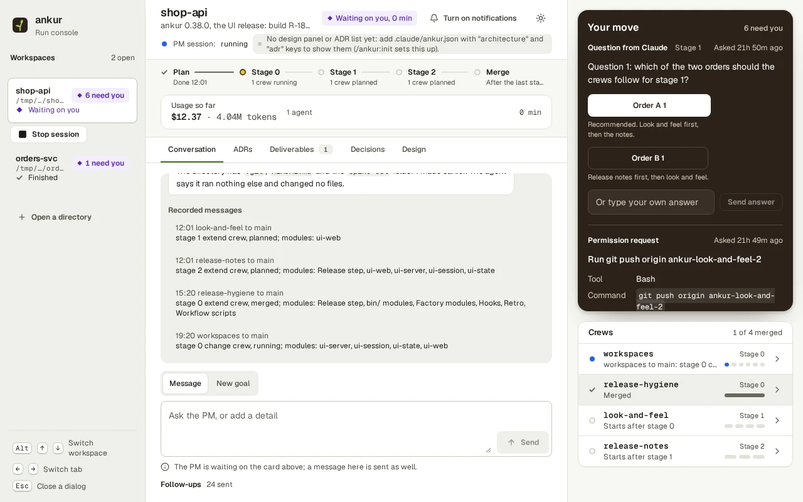

# ankur


A Claude Code plugin that grows a project-specific software factory, then uses it to ship production-grade code. It builds the agents, skills, architecture doc, ADRs and quality gates the project needs, then uses them to build goals in parallel crews, each in its own worktree, checked by tests and a QC engineer.

The name is Sanskrit: ankur (अंकुर) means "sprout".

## Install

There are two ways in. Option 1 is the plugin alone. Option 2 adds the ankur UI, which runs on top of the plugin. Run each command on its own line, in any shell on macOS, Linux or Windows.

### Option 1: the engine alone

The engine is the ankur plugin, which you drive from Claude Code. Add the claude-ops marketplace first. ankur depends on three claude-ops plugins, and `claude plugin install ankur@ankur` installs them with it. One of them is kit, which builds the project's team of agents, and `/ankur:init` runs kit's set-up for you.

```sh
claude plugin marketplace add AbhiramDwivedi/claude-ops
claude plugin marketplace add AbhiramDwivedi/ankur
claude plugin install ankur@ankur
```

Without the claude-ops marketplace, ankur fails to load. To fix it, add that marketplace, then reinstall ankur.

### Option 2: the ankur UI on top of the engine

The ankur UI is a local web page that runs on top of the engine. One Node process on your machine hosts a Claude Code session with the ankur plugin loaded, and the page shows the run live: your conversation with the project manager, the crews at work, and what needs you. It listens on `127.0.0.1` only and asks for no API key of its own.

It needs Node 24 or later, a git repo to run ankur in, and a logged-in Claude Code, because it drives your local Claude Code on your existing login. The UI is not part of the plugin install, so clone this repo, then install, build and start it from the repo root:

```sh
git clone -b main https://github.com/AbhiramDwivedi/ankur.git
cd ankur
npm --prefix ui ci
npm --prefix ui run build
npm --prefix ui start
```

The server prints one line, `ankur-ui listening on http://127.0.0.1:<port>/?token=<token>`. Open that whole URL in your browser. The page starts with no repo open: type the full path of a git repo into its "Repo path" field, or pick it with "Browse…", and open it. To start from a repo you don't have yet, use "Or clone a repository": give its URL and, if you like, the folder to clone into, and the page clones it with your own git and opens it. A private repo needs an SSH key or a git credential helper that is already set up, because git is never asked to prompt for a password. You can open several repos, one workspace each, and switch between them in the page.



[ui/README.md](ui/README.md) has the flags and how to stop it.

## Update

To move an existing install to a new version, update the marketplace, then the plugin. Installing again does not do this: it reports that ankur is already installed and leaves the old version in place.

```sh
claude plugin marketplace update ankur
claude plugin update ankur@ankur
```

Then restart Claude Code. The new version loads on the restart.

## What a run costs

A run costs tokens and time. One goal starts several agents: a project manager, builders, a QC engineer and sometimes a stress tester per crew. The agents run in parallel, so a run finishes sooner than one session would, and it spends more tokens in total. A large goal with several crews costs more than a small one.

ankur states no price of its own. `factory cost` reads the token counts of a run and turns them into dollars with a price table that you supply in the `pricing` key of `.claude/ankur.json`. A model with no entry in your price table shows as unpriced, never as zero. The run total counts spend since the plan was approved; before approval, or when a model is unpriced, it is missing, never 0.

## When not to use ankur

ankur is the wrong tool for a small change. A one-file edit, a typo, a rename or a quick fix is faster and cheaper in a plain Claude Code session: ankur would plan it, start a crew and run a QC check for a change you can read in a minute. It also does not fit work with no tests to run, because the crews prove their work with tests.

Use ankur for a goal big enough to split into parts that can be built at the same time.

## Read more

The manual is [plugins/ankur/README.md](plugins/ankur/README.md). The release history is in [CHANGELOG.md](CHANGELOG.md). The UI source is in `ui/`, and its setup is in [ui/README.md](ui/README.md).

ankur is released under the license in [LICENSE](LICENSE).
